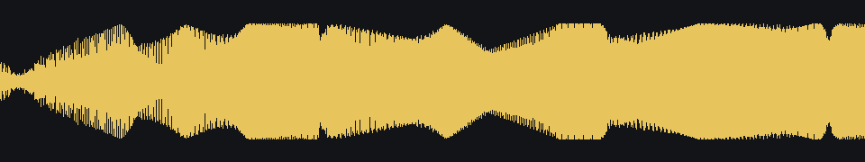

# Engine Simulator


## Live sound for sim racing

This fork plays engine-sim audio from racing-sim telemetry without running the combustion simulation while you drive. `engine-sim-bake` renders an engine script into a grid of short loops. `engine-sim-live` crossfades those loops from RPM and throttle.

The original simulator is still here, still MIT, Copyright 2022 Ange Yaghi (AngeTheGreat). The live tools are the same license.

`profiles/subaru_ej25.eslb` is a baked Subaru EJ25, from `assets/engines/atg-video-2/01_subaru_ej25_eh.mr`. `docs/live/subaru_ej25_demo.wav` is the built-in test lap rendered through that profile.



### Windows build

Install CMake, a C++17 compiler, Boost, Flex, and Bison. Those are the same dependencies the original app uses. Clone with submodules so the script compiler is present.

```
git clone --recurse-submodules <this repo>
cmake -S . -B build -DENGINE_SIM_HEADLESS=ON
cmake --build build --config Release --target engine-sim-live engine-sim-bake
```

`ENGINE_SIM_HEADLESS=ON` skips the DirectX window. On Windows the default still builds the original GUI, which needs SDL2 and the delta-studio submodule. Use the headless flag when you only want the live tools.

The Release player is `build\Release\engine-sim-live.exe` with the Visual Studio generator, or `build/engine-sim-live` with Makefiles. Play the built-in lap with no sim attached.

```
engine-sim-live --profile profiles\subaru_ej25.eslb --demo
```

`--demo` is an 8 second pull with two gear shifts. `--wav out.wav` writes a file instead of opening a sound device. `--replay lap.csv` plays a file whose header is `time_s,rpm,throttle,gear,speed_mps,load`. `python3 tools/check_live.py` runs the demo, checks that pitch follows RPM, checks that the shifts do not click, and checks a fake SimHub HTTP page plus a UDP packet.

### SimHub

Use either feed.

HTTP needs no plugin. Turn on SimHub's HTTP API. The player polls `http://127.0.0.1:8888/api/getgamedata` and reads `Rpms`, `Throttle`, `Gear`, `SpeedKmh`, and `EngineLoad` when that field is present.

```
engine-sim-live --profile profiles\subaru_ej25.eslb --source simhub
```

The UDP plugin is `simhub/EngineSimLive`. Build it against the SimHub install. The project looks in `C:\Program Files (x86)\SimHub` unless you pass `-p:SimHubDir=...`. Copy `EngineSimLive.dll` into SimHub's `Plugins` folder and restart SimHub. It sends a 24-byte little-endian packet to `127.0.0.1:21377` on every data update. The bytes are `EST1`, version 1, flags, gear, then floats for rpm, throttle, load, and speed in meters per second. Flag bit 0 is ignition. Flag bit 1 means load is valid.

```
dotnet build simhub\EngineSimLive\EngineSimLive.csproj -c Release
engine-sim-live --profile profiles\subaru_ej25.eslb --source udp
```

`--source auto` listens for that packet and also polls the HTTP API. A packet newer than half a second wins over HTTP. On Windows, `--source ac` reads Assetto Corsa shared memory at `Local\acpmf_physics`. Auto uses that mapping only when nothing else has arrived. The shared-memory path was not run against the game here.

Gear is not a sound input. A shift is an RPM step. The player slews RPM over about 20 ms and fades loops over about 15 ms, so the join does not click.

### Bake another engine

The script defines `public node main` and that node calls `set_engine`, which is how the scripts in `assets/engines` are written. A script that only defines `main` is wrapped and called. From any working directory:

```
engine-sim-bake --script assets\engines\atg-video-2\03_2jz.mr --root <repo> --out profiles\2jz.eslb
```

`--root` is the repository root, so `es/` and the impulse-response wavs resolve. `--rpm` and `--demand` are comma-separated grids. The default grid is 1000, 2000, 3000, 4000, 5000, 6000 rpm and demand 0.15, 0.55, 1. Demand is engine load when the sender marks load valid, and throttle otherwise. Stay under the script redline. The rev limiter cuts spark and the recorded loop goes quiet.

### CPU

Measured on a 4 core Intel Xeon with load average 0.06. Both binaries were Release builds (`-O3`). Five runs alternated live and stock, about 5 seconds each. Process CPU is `getrusage` user plus system time, taken over the timed section only. Stock is the headless simulation and synthesizer held at 4000 rpm and demand 0.8, sleeping when it gets ahead of the clock. The original GUI was not in the process, so a windowed engine-sim costs at least this much. Live is `engine-sim-live --demo --realtime`.

Per second of audio, the live player used 0.42% of one core. The mixer inside that number was 0.12% of one core. The stock headless sim used 59% of one core. Of the stock time, the simulation step was 78% and the synthesizer was 22%. The simulation step runs the rigid-body solver and the gas system. Its timer wraps `startFrame`, `simulateStep`, and `endFrame`. The synthesizer timer wraps `renderAudio`. The simulation step is the limiter. The live player does not run it.

Median process CPU was 0.0208 s for 5.004 s of live audio, and 3.215 s for 5.490 s of stock audio. Stock produced a little more than 5 s of audio because each 20 ms step emits slightly more than 20 ms of samples. The 59% figure divides stock CPU by audio seconds, not by wall time.

---
# Engine Simulator has moved!

To get the newest releases of the game, [click here](https://github.com/Engine-Simulator/engine-sim-community-edition).
---

## What is this?

This is a real-time internal combustion engine simulation **designed specifically to produce engine audio and simulate engine response characteristics.** It is NOT a scientific tool and cannot be expected to provide accurate figures for the purposes of engineering or engine tuning.

## How do I install it?

This is a code repository and might not look like other software that you're used to downloading and installing (if you're not familiar with programming). To download a ready-to-use version of the application, navigate to the [releases page](https://github.com/ange-yaghi/engine-sim/releases), find the most recent release (ex. `v0.1.5a`), click "Assets" and download the .zip file with a name that starts with `engine-sim-build`. Unzip this file, then run `bin/engine-sim-app.exe`. The simulator should then start normally.

Check out [our Frequently Asked Questions](https://github.com/ange-yaghi/engine-sim/wiki/Frequently-Asked-Questions) if you need more details.

## How do I use it?

The UI is extremely minimalistic and there are only a few controls used to interact with the engine:

| Key/Input | Action |
| :---: | :---: |
| A | Toggle ignition |
| S | Hold for starter |
| D | Enable dyno |
| H | Enable RPM hold (see below for instructions) |
| G + Scroll | Change hold speed |
| F | Enter fullscreen mode |
| I | Display dyno stats in the information panel |
| Shift | Clutch (hold spacebar at the same time to slowly engage/disengage) |
| Up Arrow | Up Gear | 
| Down Arrow | Down Gear | 
| Z + Scroll | Volume |
| X + Scroll | Convolution Level |
| C + Scroll | High frequency gain |
| V + Scroll | Low frequency noise |
| B + Scroll | High frequency noise |
| N + Scroll | Simulation frequency |
| M | Increase view layer |
| , | Decrease view layer |
| Enter | Reload engine script |
| Escape | Exit the program |
| Q, W, E, R | Change throttle position |
| Space + Scroll | Fine throttle adjustment |
| 1, 2, 3, 4, 5 | Simulation time warp |
| Tab | Change screen |

### Using the RPM hold
The RPM hold feature will hold the engine at a specific RPM and also measure the engine's horsepower and torque at that RPM. You can enable RPM hold by pressing the `H` key. **You must then enable the dynomometer** (press the `D` key) in order for the RPM hold to take effect. To change the hold speed, hold the `G` key and scroll with the mouse wheel. The RPM hold will be shown on the `DYNO. SPEED` gauge in the lower left of the screen.

## Why is the code so sloppy?

I wrote this to demo in a [YouTube video](https://youtu.be/RKT-sKtR970), not as a real product. If you would like it to become a usable product please reach out to me or join my Discord (link can be found in the description of the aforementioned YouTube video). I use this codebase for my own purposes and so it might change frequently and without warning.

## How do I build it? (Ignore this section if you're not a developer!)
**Note: this project currently only builds on Windows!**

### Step 1 - Clone the repository
```git clone --recurse-submodules https://github.com/ange-yaghi/engine-sim```

### Step 2 - Install CMake
Install the latest version of CMake [here](https://cmake.org/) if it's not already installed.

### Step 3 - Install Dependencies
You will need to install the following dependencies and CMake will need to be able to locate them (ie. they need to be listed on your PATH):

    1. SDL2
    2. SDL2_image
    3. Boost (make sure to build the optional dependencies)
    4. Flex and Bison

### Step 4 - Build and Run
From the root directory of the project, run the following commands:

```
mkdir build
cd build
cmake ..
cmake --build .
```

If these steps are successful, a Visual Studio solution will be generated in ```build```. You can open this project with Visual Studio and then run the ```engine-sim-app``` project. If you encounter an error telling you that you're missing DLLs, you will have to copy those DLLs to your EXE's directory.

## Patreon Supporters

This project was made possible by the generous donations of the following individuals!

### Grease Monkeys

|<!-- -->|<!-- -->|<!-- -->|<!-- -->|<!-- -->|
|-|-|-|-|-|
|Devin@Hondatuningsuite|nut|Devin C Martinez|WelcomeCat|Saints Sasha|
|Ida 8858|Emily|Steelorse |Kruddy|Sgt. Fluff|
|darcuter|FatFluffyFox|Benton1234|Jim C K Flaten|The Zuck|
|Blade Skydancer|Ye' old apple|Hayden Henderson|AlphaX|Lucas Martins Bündchen|
|Jay Dog|damo|IBS-IS-CRAP|Snowy|Noah Greenberg|
|Eisberg|Brendan M.|Alex Layton|Lukas Bartee|Thibaut Dubuisson|
|The Cheeze Ity|JoeJimTom|MichaelB450|Björn|Bartdavy|
|sasha bandelier|Caleb Black|COOKIES|Andrew Cooper|asimo3089|
|Vim Wizard|Kevin Arsenault|Carl Linden|Kele Tappi|Kroklethon|
|labourateur|viperfan7|SlimmyJimmy|Jason Becker|Sascha Kamp|
|ves|Supernalboot |BeamNG|Paul Harrison|Tyler Russell (Nytelife26)|
|nicholas jacobs|DrDotMadness|AVeryPlainTyler|Zach Perez|Paul Schaefer|
|Clay Bauer|CR33DYM0N14|julien nadeau|Patt313|Philip Edwards|
|RegularRuby670|Mateusz Ładosz|FémLol Stúdió|Crazy Yany|Elden|
|Tristan Walker|Matthew McDonald|Jan-Sander Huiting|Mitchell Almstedt|Dylan Lebiedz|
|Name Here|LoganBoi FNAF|Epic Randomness|MrPiThon|mike |
|dung|Alvaro ArroyoZamora|Skinna Godwin|BeppoBarone|レナVA|
|Sabata |Brady Fulham|Powerpuncher |NK10K|Gavin Osowski|
|Orbitstrider|Steven Doyle|Jaksu2696|Toni |Devin Abolins|
### Tuners

|<!-- -->|<!-- -->|<!-- -->|<!-- -->|<!-- -->|
|-|-|-|-|-|
|Boosted Media|Matthew McLennan|Venican|Lyan le Golmuth|Alberto R.|
|BetaToaster|Akira Takemoto|J Anderson|Apolly007|LexLuther|
|xilophor|Robert K|viktor lind|Adrian Kucinski|sarowie .|
|Chris Fischer|Marlod|Chase Hansen|Aidan Szalanski|Andrew Taylor|
|Jason Hwang|Juuso Natunen|Ian Moss|PickleRick |Beljim46|
|RSOFT92|UCD|Sped|OldManJenkins|James Hart|
|Kalle Nilsson|XxBrasta455xX |Colin Sandage|Dakota Mackinnon|Carter Kopp|
|Jakub Kozak|CJ Plessas|Loizeau|Charles Mills|YellowLight|
|Didrik Esbjug|Alessandro Dal Pino|Carter Williams|Robert D|Cadence Plume|
|BLANK|Provenance EMU|Dylan Engler|Nathan Rojas|Cornelius|
|Acid|larsloveslegos|Maxime Desages|GM|BreadForMen|
|Devin Freeman|Lieven RYCKEBOER|Amelia Taylor|Jelle Plukker|sodmo |
|Jimmy Briscoe|Cirithor|Martin .K|DMartland|Lucas Diem|
|Richard Budíček|Jack Sheppeard|Meemen|Anderson Huynh|NPException|
|Mattia Villa|C|AIDAN POWELL|Brenn_the_Otter|Lane Mosier|
|Ceze |oranjest1|Jw|ISON |Mathew Graham|
|MACHINA|John Crowell|Asher Blythe|Cronos Skies|Matt Amott|
|CpTKugelHagel|Simon Krayer|Caleb Bek|Monster Man25|GeneralMoineau|
|EsuKurimu|Caleb Sartin|Jared L.|Hunter Wood|Ben Poole|
|Steven Victoria|Jordan Zondlak|Agelessgod|Christopher Fahs|Jonathan Vincent|
|Dalton Guillot|Simon Stojanovic|Andrew Urbanczyk|deniaL|Tyler Hughes|
|vPam |Justin Kruithof|Curtis C Coomber|Sawyer Clark|Mike Hart|
|Ciro Rancourt|Miles Guo|Rewind |E=mc^2|Keaton Call|
|J.Es|Jeremy B|Chance Hall|Jack Tompkins|Race Sim Studio|
|Quentin ZAOUI|Floyd Henderson|James Haylow|Milkshiekh |Wyatt Todd|
|User 2820|Leon Schutte|CYBERBUG_JR|sebiii|Keegan|
|Victor Cosiuga|Rolly !|Elias Pettersson|Tyson Makovec|Bill McDermott|
|Phontonic|Simon Armstrong|avec |KidozyGAME (Dead)|Stephan Cote|
|Justin Biggerstaff|Jabba Jubba|notD34THNIGHT|Inventor|Wesley Bear|
|Supersonic2510|Pixel|Simon Bernhardt|Bas Vangermeersch|ToyotaCipra|
|kyle crawford|ApatheticWood|Ben Vaughn|Erich Westhoven|Zack Myers|
|Tbjoern|Vetle Høgås|Derek Thom|Aaron Beck||
### Junior Mechanics

|<!-- -->|<!-- -->|<!-- -->|<!-- -->|<!-- -->|
|-|-|-|-|-|
|Karol Szép|Leon Jordan|Nathan Higginson|Patrick F|Samuel Picard|
|Alexander Fritsch|Lucas Scarpi|Jack Humbert|G2Eneko|SweCreations|
|Marius Becker|Cedric Wille|infernap12 |Julian Dinges|Wamuthas|
|Alex Mason|Hawar Karem|Melonenstrauch|Jacek Dębski|Alex Eastman|
|Darren Taing|Po Wang|Giorgio Iannucci|Levis|Eden|
|Alin Chiparatu|Arjun Mandakath|A.M. |Dylan Ryan|Noah Entrekin|
|GT130|Josh D|generic|Henrik Cohrs|Nic Yetter|
|Dan Fredriksen|153AN1MJ|Rasmus|EpicEcho|Kaur Hendrikson|
|Maddox Partridge|L33TIFY_|Zack Fletcher|teiiio|Mike Zaite|
|Evan Sonin|Christopher Zimmerman|PrefacedVase |funtomr|Triton Alabaster|
|appelpie|Julien Ferluc|AnomalousFerret_|Miles Orozco|Spencer Teeter|
|ThatCanadian|Harry Prabowo|Dylan Rogerson|Jaedyn Allen|Zephyr Sefira|
|Alexander Stone|Mason Little|Wojciech Czop|ryzen5 |Kosta Diamantis|
|Karol Stodolak|Tim van der Linde|Loïc Ruttner|jonthefuzz|AsgarK|
|James Morgan|Elijah |1ntl|Tobias Johansson|Mome |
|P|SOPA_|Shingekuro|Sean King|Russell Marsh|
|Alyx Ranas|Naters305 |ChrisakaMrXD |Nic |sean|
|Zach Hagedorn|Jhon lenon|Everett Butts|Kyan|ranger Nation|
|Hiago Oliveira|Texi|MrRhody|Inglorious Bastard|Marty Mitchell|
|Justin Chao|ManuelS|Cornelius Rössing|Pedro Freire|Anthony Stuart|
|Hubba Nubba|Skychii|Joe Underwood|Xander_|Notbigdank|
|Sander D.|Lars Joosten|Danksa|Metrostation |Myles Wommack|
|Derrick Sampson|Corey Hannen|Matteo La Corte|Octothorp Obelus|David Baril|
|Soyuz Kafire|Ivan Coha|BigElbowski|Apolepth|Julian Krad|
|David Soulieres|Eric Huang|Léo Vias|Riccardo Mariani|Vic Viper|
|Shinkaaaa|Mumaransa |Michael Banovsky|Hendrik Voss|Inverted Blackhat|
|skipyC |Tobias Moor|jaky3 .|Clément LEGRAND|Ian C. Simpson|
|Challier|Jan Przemysław Drabik|Dsand23|Smooth DLX|The German Dude|
|CrazyEagle |Jordon Goodman|HenryWithaG .|Oscar Krula|Brayden Moore|
|Steven|Nall Wolfert|papajonk|Andrew|Ben Kingston|
|Julian Vogl|Maxime Lubrano|MrMekouil|Doudimme|Jacob Hultberg|
|Nolan Orloff|Mike|tobi9899 |Danila Frolkin|Xecotcovach|
|Aj|Carcar404|John Martin|Dominik Greinert|Lukas Stadler|
|Oliver Yang|sonax51|Marcel Kliment|Chris|David Rush|
|LethalVenom13|Dave Osterhoff|Anto1709|Ben|Morgan Munroe|
|Ivor Forrest|Sam Hopkins|Atte |Dax |William Bergström|
|homelessmeme|Thanleft|Zaxerg |Robeloox|Maximilian-Lukas Marz|
|Morgn|Seth Monteleone|playfulmean videos|Lanimations LA|Bram G|
|Benoit Fournier|Bernar Lepiller|Nicolas Baur|the |Snekers|
|Darkmount|Tobiasz Michalik|Aidas Ri|Daniel Postler|Skim_Beeblez|
|Impetus|Thunderbird324|Fred Joss|Krzysztof Radowski|Azerrty|
|Harrison Speck|Matt Baker|BigLynch|Markus Pelto|IMBIBE|
|James L Plummer|Rose Giles|Jonas Brekka|HASTRX|Lepoucehumain|
|Naomi Humin|qkrrudgks|Johann Gross|Janis Knappich|WhatTheDuck|
|테루|Glimple Bort|Jacob Tudisco|Tanner|Julian kaspi|
|nathan gould|Randal Rainis Kruus|Beppierre|Craig Martin|Thomas Bukovsky|
|Colaxe|Robert Oram|Matsuy15 L|Kacpe|Alex Sedlic|
|Mark Benson|Mhenn!|Anders Nelson|Dingus|Rustle|
|Marco Schulz|stratum |brochier gabriel|Thomas|brody of hillcountry|
|Thomas Afford|Brody Blaskie|Martien Gaming|Adrien MC|William A Grubbs|
|Trevo Ph.D.|Donovan Gibson|Polish R3t4rd|Keith Price|LAWL CAKE|
|Rhien Schultz|FireThrow13|Seraphim|Titus Standing|Matt Miklos|
|B Dub|Jonathan Ekman|Al Pomeroy|Vestii|Wil|
|adrian|Airatise|TJ Sinkoski|Shotts SilverStone|Reagan Carbaugh|
|WarAestheticsRebooted|Aidan Case|Casey Bryant Goodwin|Konrad|Adam Larcher|
|Kazar Xin Xiao|Riccardo Marcaccio|William S.|Francis Filion|Loïc |
|Kenny Deane|Blackspots|mike |MXT|Joshua Gibson|
|milky boi|Hagen|gunmaster929 |jgvan |Benny 282|
|Sean Wehner|Christian Poole|Ethan|Tsukiyama Shuu|Ooof_uhhh_haah|
|sano ken ch|Diego Martinez|Chuck|GalaxyFrogs|TheGeForce |
|Chriphost|Carthage|Greg L|Chipskate|Muhammed Mehmood|
|Hamilton Sjoberg|Amina Moh|vSiiFT|Jeremy Wren|Esteban Acosta|
|John A Ullenberg|Michael Morozov|Andrew Webberley|Nathaniel Lim|Aaron Ksicinski|
|Apocalypt|Josh batuzich|Ed|Hunter |Gene Brockoff|
|Redheadspellslinger.|Pablo Magariños|Nilz|Jose Manuel Silva Calvo|AJ|
|Ethan Wille |Aurora|Derek Shunia|Jan|Nope Mircea|
|Giancarlo Cestari|Tanner Edge|brad.|Connor Merrick|Martin Scholer|
|Deppy|Dan Smith|Tyson |Jac Comeau|Itemfinder |
|Tischer Games|Pedro Henrique|BeenWashedUp|martin wolff|Kurt Houben|
|Thomas Onslow|Brendan Puglisi|Kai Anquetil|Rudolph Ignatenko|CloudHackIX|
|Zach Carreau|Jonathan Vanderlyn|Krobivnov|ienergy|Leifster|
|Mikael Kaaronen|Glen|H.Helsing|ange|The Nobles|
|Johnathan Johnson|Juha Merentie|Jim Fares|Tom Marshall|Superferrariman|
|Zakary Zisa|JustTy|晟道 杜|Dnialibr Williams|Takumi Fujiwara|
|Koen van Hal|Jonathan Hill|Marco Siciliano|Kevindosenfutter|Angry Prawn|
|Natharic 67|Rafael Monteiro|Jacob Ashline|ChironTheFloof|Caleb Dauphinee|
|Tony |Zac L|AlainMoto FPV|eirik johan johnsen|Elderet|
|Miles Longmore|lemon head|Viccy|Casey|Kajetan Cupa|
|Conejero00|Bill Gricko|A cow wearing a turban|Danni Nowicki|Udo Schmidt|
|Tyler Swords|Constellation Gaming|Manimo|valentine|Jules Schattenberg|
|Brandon Crotts|Philipp Popetschnigg|Tiziano Della Fazia|goodgamer1109|Joshua Thomas|
|Jeff Testa|Avery Snyder|Josh Kern|Triptagram|Bayon Antoine|
|Iván Juárez Núñez|Amery Martinat|ElArGee|Cory Green|lucas Di lorenzo|
|Caleb Sandersier|||||
